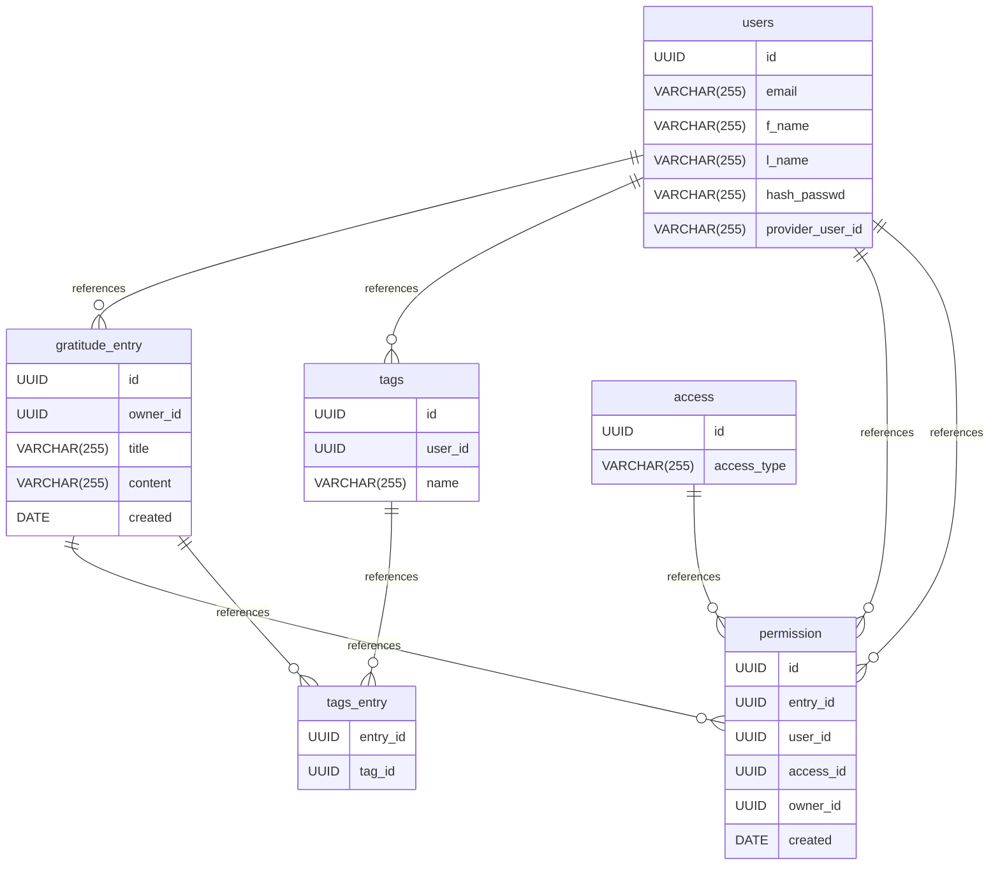

# Gratitude Jar documentation
## Summary

- [Introduction](#introduction)
- [Database Type](#database-type)
- [Table Structure](#table-structure)
	- [users](#users)
	- [gratitude_entry](#gratitude_entry)
	- [tags](#tags)
	- [access](#access)
	- [permission](#permission)
	- [tags_entry](#tags_entry)
- [Relationships](#relationships)
- [Database Diagram](#database-diagram)

## Database type

- **Database system:** PostgreSQL
## Table structure

### users

| Name                 | Type         | Settings        | References                                                                                    | Note |
| -------------------- | ------------ | --------------- | --------------------------------------------------------------------------------------------- | ---- |
| **id**               | UUID         | 🔑 PK, not null | fk_users_id_gratitude_entry, fk_users_id_tags, fk_users_id_permission, fk_users_id_permission |      |
| **email**            | VARCHAR(255) | not null        |                                                                                               |      |
| **f_name**           | VARCHAR(255) | null            |                                                                                               |      |
| **l_name**           | VARCHAR(255) | null            |                                                                                               |      |
| **hash_passwd**      | VARCHAR(255) | null            |                                                                                               |      |
| **provider_user_id** | VARCHAR(255) | null            |                                                                                               |      | 

### gratitude_entry

| Name         | Type         | Settings        | References                                                         | Note |
| ------------ | ------------ | --------------- | ------------------------------------------------------------------ | ---- |
| **id**       | UUID         | 🔑 PK, not null | fk_gratitude_entry_id_permission, fk_gratitude_entry_id_tags_entry |      |
| **owner_id** | UUID         | not null        |                                                                    |      |
| **title**    | VARCHAR(255) | null            |                                                                    |      |
| **content**  | VARCHAR(255) | not null        |                                                                    |      |
| **created**  | DATE         | not null        |                                                                    |      | 

### tags

| Name        | Type         | Settings        | References            | Note |
| ----------- | ------------ | --------------- | --------------------- | ---- |
| **id**      | UUID         | 🔑 PK, not null | fk_tags_id_tags_entry |      |
| **user_id** | UUID         | not null        |                       |      |
| **name**    | VARCHAR(255) | null            |                       |      | 

### access

| Name            | Type         | Settings        | References              | Note |
| --------------- | ------------ | --------------- | ----------------------- | ---- |
| **id**          | UUID         | 🔑 PK, not null | fk_access_id_permission |      |
| **access_type** | VARCHAR(255) | not null        |                         |      | 

### permission

| Name          | Type | Settings        | References | Note |
| ------------- | ---- | --------------- | ---------- | ---- |
| **id**        | UUID | 🔑 PK, not null |            |      |
| **entry_id**  | UUID | not null        |            |      |
| **user_id**   | UUID | not null        |            |      |
| **access_id** | UUID | not null        |            |      |
| **owner_id**  | UUID | not null        |            |      |
| **created**   | DATE | not null        |            |      | 

### tags_entry

| Name         | Type | Settings        | References | Note |
| ------------ | ---- | --------------- | ---------- | ---- |
| **entry_id** | UUID | 🔑 PK, not null |            |      |
| **tag_id**   | UUID | 🔑 PK, not null |            |      | 

## Relationships

- **users to gratitude_entry**: one_to_many
- **users to tags**: one_to_many
- **gratitude_entry to permission**: one_to_many
- **users to permission**: one_to_many
- **access to permission**: one_to_many
- **users to permission**: one_to_many
- **gratitude_entry to tags_entry**: one_to_many
- **tags to tags_entry**: one_to_many

## Database Diagram

